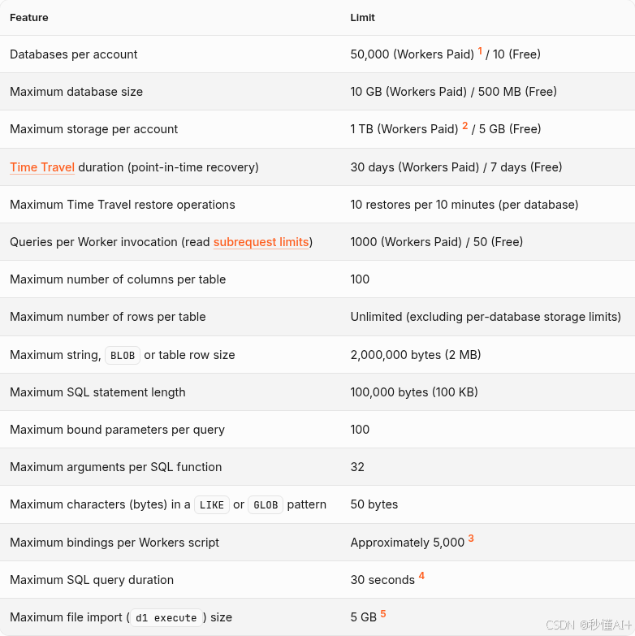
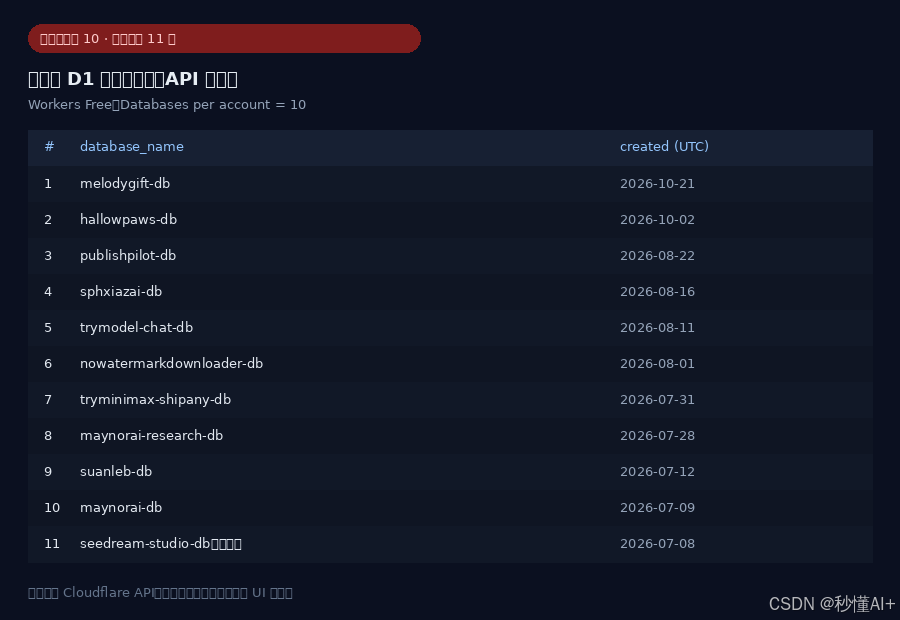
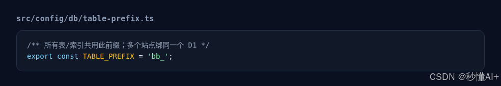
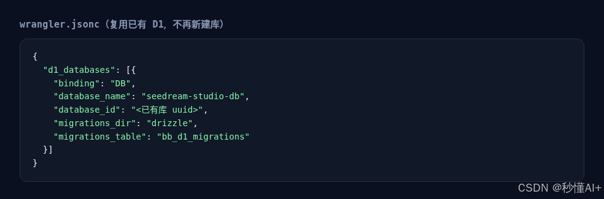
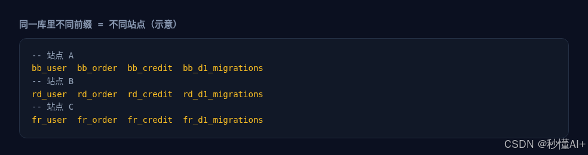

> 在线阅读（GitHub Pages）：https://maynor996.github.io/cloudflare-d1-table-prefix/

# 免费 Cloudflare 只有 10 个 D1？满了之后的「穷鬼打法」：表前缀复用同一个库

上新站的时候，最容易踩的坑之一是：**Workers 免费档，每个账号最多只能建 10 个 D1 数据库**。

官方 limits 写得很清楚：Databases per account —— Paid 很多，**Free 就是 10**。



（图注：Cloudflare D1 官方限额：免费档最多 10 个数据库）


## 满了之后长什么样

额度一满，再想给新项目「新建一个 D1」就会直接卡住。预览/部署侧常见提示大概是这样：当前账号 D1 免费额度已满（例如已经有 11 个库），**没法再 create**；KV / R2 / Queues 可能都备好了，就差这一步。


（图注：D1 免费额度已满、无法新建库的提示）


用 API 把账号里现有的库拉出来，一眼就能看到已经顶满（本例 11 个，共享业务库是 `shared-app-db`）：



（图注：本账号 D1 列表（API 实拉））


这时候有两条路：

1. **删掉 1～2 个不用的库**，或者升级 Workers Paid  
2. **穷鬼打法**：不再新建库，**多个站点共用同一个 D1，用表名前缀把数据隔开**

下面讲第 2 条。

## 穷鬼打法：一个 D1，多个前缀

核心就一句话：

> 库还是那一个；每个站点给自己的表加固定前缀（`bb_`、`rd_`、`fr_`……），迁移表也用各自的 `*_d1_migrations`。

这样：

- **不占用新的「数据库名额」**（还是 1 个 D1，算进那 10 个里的同一个）  
- 站点之间表不撞名  
- 每个 Worker 仍然 `binding: "DB"` 指到同一 `database_id`

### 1）改表前缀

项目里通常有一个很小的配置文件，例如：



（图注：TABLE_PREFIX 配置示例）


```ts
/** 所有表/索引共用此前缀；多个站点绑同一个 D1 */
export const TABLE_PREFIX = 'bb_';
```

换站点就换前缀：`rd_`、`fr_`、`jp_`……**一个前缀对应一个产品**，别复用。

### 2）Wrangler 复用已有库，而不是 create

新建站时，**不要**再跑「创建 new D1」。直接把 `d1_databases` 指到已经存在的那一个，并指定本站自己的 migrations 表：



（图注：wrangler 复用已有 D1 配置）


```jsonc
{
  "d1_databases": [{
    "binding": "DB",
    "database_name": "shared-app-db",
    "database_id": "<已有库 uuid>",
    "migrations_dir": "drizzle",
    "migrations_table": "bb_d1_migrations"
  }]
}
```

注意两点：

- `database_id` 用**已有库**的 UUID  
- `migrations_table` 必须带本站前缀（`bb_d1_migrations` / `rd_d1_migrations`……），否则多家迁移会互相踩

### 3）同一库里看起来像这样

共享库里会并存多套「平行宇宙」表（示意）：



（图注：同一 D1 内多套前缀表示意）


```text
-- 站点 A
bb_user  bb_order  bb_credit  bb_d1_migrations
-- 站点 B
rd_user  rd_order  rd_credit  rd_d1_migrations
-- 站点 C
fr_user  fr_order  fr_credit  fr_d1_migrations
```

## 实际能撑多少站？

免费档限制的是 **「数据库个数」**，不是「表的个数」。  
所以理论上：**1 个共享 D1 × N 个前缀 ≈ N 个站点的业务表**，仍然只占 1 个名额。

我们这边就是这个路数：账号 D1 列表已经顶满免费档，新站继续绑同一个共享库、换前缀上线——**不是鼓励大家永远不升级，而是额度卡住时还能继续发版。** 模型侧调用的话，我平时会顺手走 tryallapi.com 这类聚合接口，和「库满了换前缀」是两件独立的事，互不耽误。

## 注意事项（别省出事故）

1. **前缀一定要全局唯一**，两个站共用 `bb_` 等于两套业务写同一批表。  
2. **migrations_table 也要带前缀**，否则 migration 历史串台。  
3. 共享库有 **整库 500MB（Free）** 和账号存储上限；站多了要盯容量，不是无限囤。
4. 当天 **row read / row write** 免费额度是账号级的，站一多更容易顶满——这和「库个数」是另一道墙。  
5. 备份 / Time Travel / 误删风险：共用库，操作前看清楚前缀。  
6. 真要隔离合规或大流量，该升级 Paid、该拆库还是拆；穷鬼打法是过渡方案。

## 小结

| 做法 | 效果 |
|------|------|
| 每站新建一个 D1 | 免费档最多约 10 站就顶满 |
| 删库 / 升级 Paid | 合规、省心，但要动手或花钱 |
| **表前缀 + 复用同一 D1** | **不占新名额，继续上站** |

所以：免费 CF 只有 10 个 D1 时，满了怎么办？  
**别再 create 了——给表加前缀，挤进同一个库。这就是穷鬼打法。**